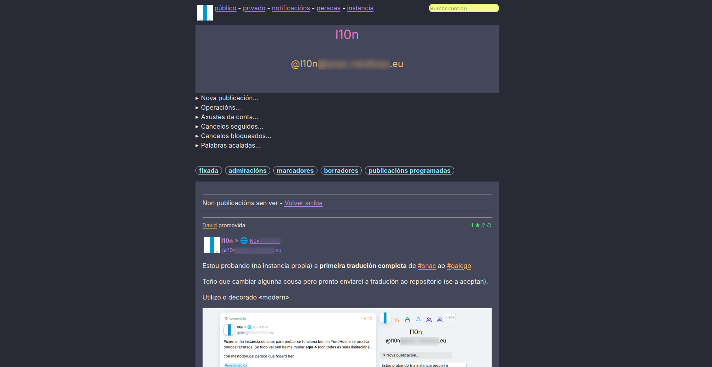

# Dracula for [snac2](https://codeberg.org/grunfink/snac2)

> A dark theme for [snac2](https://codeberg.org/grunfink/snac2).

## Install

* create `style.css` inside user's profile `static` dir
* open `style.css`
* paste `snac-dracula.css`'s content

## Contributor

This theme is maintained by 

## Contact

- [ghose at ⁂](https://gts.xmgz.eu/@ghose) - ghose at fediverse ⁂

## Dracula PRO

## License

[MIT License](./LICENSE)
